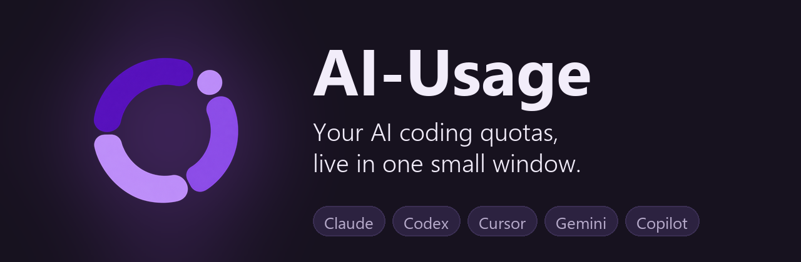
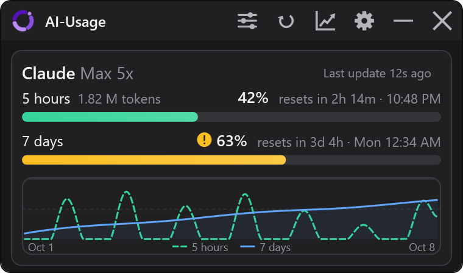
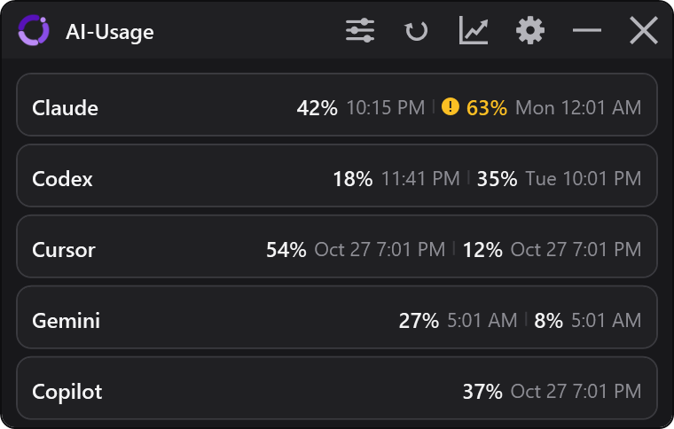
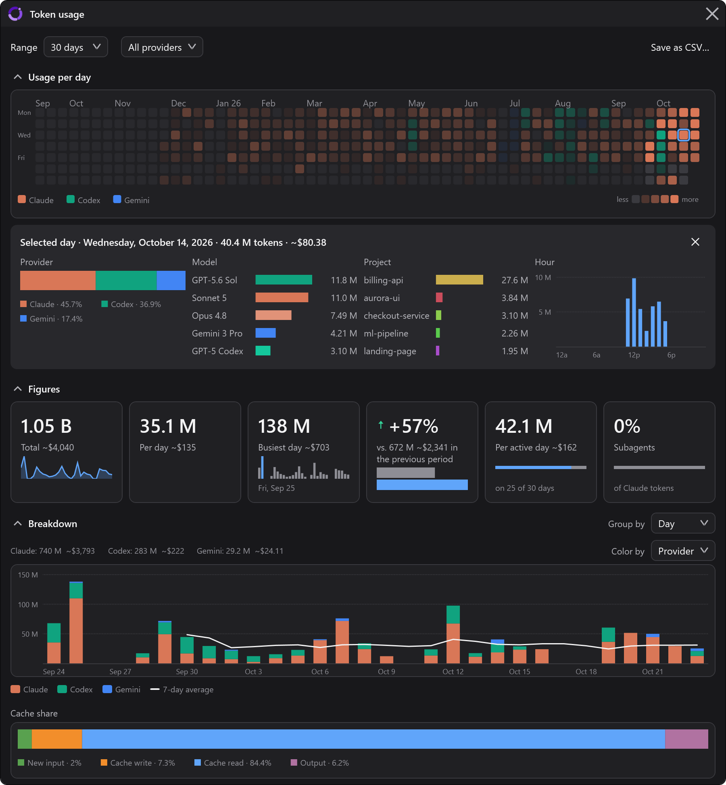

<div align="center">

<h1></h1>

Claude, Codex, Cursor, Gemini and Copilot side by side, with a countdown to every reset,<br>
so the next "usage limit reached" never catches you mid-flow.

[](../../releases/latest)


[](LICENSE)



</div>

## Why AI-Usage

Which tool still has room? When does the 5-hour window reset? How close is the weekly cap?
AI-Usage sits in a corner of your screen (or just in the tray), reads the numbers straight from the
tools you already use and shows them as bars, countdowns and history charts. No accounts to create,
no API keys to paste, nothing to configure before the first number shows up.

## Supported agents

| Agent | What you see | Where the numbers come from |
| --- | --- | --- |
| **Claude** (Claude Code) | 5-hour and weekly limits, every extra window the account reports, token statistics, the API credit balance of your Claude Console | The sign-in Claude Code already has on this PC and its local session logs; an optional browser session for further accounts and for the credit balance |
| **OpenAI Codex** | 5-hour and weekly limits, token statistics | Codex's local session files; a signed-in browser session as a fallback |
| **Cursor** | Monthly plan usage, split into Cursor's own models and API models where the plan reports it | A signed-in browser session |
| **Google Gemini** (Antigravity) | Quota windows with their reset times, token statistics | The account the Antigravity CLI (`agy`) is signed in with, and Google's usage page through a signed-in browser session |
| **GitHub Copilot** | Monthly premium requests | The GitHub CLI (`gh`) you are already signed in with |

More than one account per agent? Add it, and it gets its own tile, name and history.

<div align="center">

<br><sub>Every supported agent at once, small layout</sub>
</div>

## Highlights

**At a glance**
- Every usage window as a bar with percentage, countdown ("resets in 2h 14m"), tokens and a "full
  in about 3h" forecast; a tick shows how much of the window's time has passed
- Bars colored by level (with a warning sign, never colour alone), or split by model or by main
  agent and subagents
- A tray icon showing the busiest quota, or the agent and window you pick
- A waiting mark on Claude, Codex and Gemini when the agent has finished and waits for your reply
- Windows notifications at thresholds you set, before a window fills, when a limit is reached and
  when it is free again, or when a sign-in expires; they respect Do Not Disturb and quiet weekdays,
  and offer "Not again today"
- History over 24 hours up to everything, kept locally for up to ten years
- Clear errors (timeout, HTTP code, no connection) that keep the last numbers in view and link to
  the agent's status page; a hint when an agent changes its answer
- "Use local sources only" per account for Claude, Codex and Gemini

**Made for your desktop**
- Tiles stacked or side by side; the window sizes itself and switches between full and small layout
- Always on top, on the desktop, click-through overlay, adjustable opacity; hides during full-screen
  games, videos and presentations
- Widget size 90 to 150 %; themes System (light/dark, accent color, optional Mica), Nebula,
  Terminal, Dark, Light and high contrast
- Autostart, timed refresh, update check and "Pause for 1 hour" in the tray menu
- One backup file for settings, history and token index; import the token history of a second PC;
  a weekly copy of the index repairs a damaged one on its own
- Remembers its place for up to three display setups
- Removing an account removes its sign-in in AI-Usage, and its history if you tick it
- Light on your PC: slows down while the screen is locked and on battery; the hidden sign-in
  browser is released after 15 idle minutes
- 12 languages: English, German, Spanish, French, Italian, Dutch, Polish, Portuguese (Brazil), Romanian, Turkish, Japanese and Simplified Chinese

## Token usage window

Quotas tell you how much is left; the token usage window shows where it went. It reads the local
session logs of Claude Code, Codex and the Antigravity CLI, builds its own index and turns them into
a dashboard for any period (7 days, 30 days, a month, a year, everything or a custom range).

- **Activity grid:** one square per day, colored by the leading agent; click a day for its agents,
  models, projects and hours
- **Key figures:** total, average per day, busiest day, change against the previous period
- **Breakdowns:** input, output and cache tokens by day, week, model, project or effort, with a
  7 day average; shares per agent, model, effort and subagent
- **Filters:** pick agents, or click a model or project to filter every section
- **Projects and sessions:** the folders and sessions that used the most tokens; moved projects
  count as one
- **Patterns:** per weekday, per hour and as a weekday by hour grid
- **Limits:** how often you hit each limit, and how many tokens one percent of a window holds per
  model, from your own usage
- **API cost estimate:** what your tokens would cost at public API prices, in dollars, euros or your
  region's currency, marked with ~ (a star marks sums with a model of unknown price). Switch it off
  under **Settings > Display > Show API cost** and nothing is downloaded.
- **CSV export** of all figures, and a layout you arrange by dragging sections (or Alt+Up/Down)

Cursor and Copilot keep no token counts on your PC, so the window says so instead of guessing.

<div align="center">

<br><sub>The token usage window</sub>
</div>

## Keyboard shortcuts

| Where | Keys | What it does |
| --- | --- | --- |
| Widget | F5 | Refresh now |
| Widget | Ctrl+, | Settings |
| Widget | Ctrl+T | Token usage window |
| Widget | Ctrl+L | Providers and layout |
| Widget | Alt+Space | Window menu |
| Anywhere | Ctrl+Alt+U | Show or hide the widget (off until you turn it on in the settings; keys changeable) |
| Anywhere | Ctrl+Alt+Left, Ctrl+Alt+Right, Ctrl+Alt+Up, Ctrl+Alt+Down | Snap the widget to a half of the screen |
| Token usage window | Esc | Close (first cancels a running drag) |
| Token usage window | Alt+Up, Alt+Down | Move the focused section |
| Token usage window | Arrow keys, Home, End | Move through the bars and days of a chart |

## Use it in your terminal

While AI-Usage runs, it keeps `%APPDATA%\AI-Usage\status.json` (or the data folder you chose) up to
date, always written as a whole file:

```json
{
  "version": 1,
  "updated": "2026-10-10T14:03:09+02:00",
  "providers": [
    {
      "id": "claude", "name": "Claude", "account": "Work", "status": "ok",
      "windows": [
        { "kind": "fiveHour", "label": "5 hours", "usedPercent": 42, "resetsAt": "2026-10-10T16:17:00+02:00", "tokens": 1823457 }
      ]
    }
  ]
}
```

`status` is `ok`, `stale`, `failed`, `signin` or `unavailable`; `kind` is `fiveHour`, `weekly` or
`other`; `resetsAt`, `tokens` and `account` are `null` when unknown. A Claude entry also carries
`apiCredit` (`amount`, `currency`) once a Claude Console credit balance was read. The file holds only numbers and
the names you chose, never an e-mail address.

`AI-Usage.exe --status` prints one line per provider and exits (`--status --json` prints the file;
exit code 1 without one). In a plain console, pipe it (`| more`) so the lines do not land after the
prompt. As a Claude Code status line:

```json
{ "statusLine": { "type": "command", "command": "C:/path/to/AI-Usage.exe --status" } }
```

```text
Claude (Work) 42% 5h (2h 14m) · 63% week (3d 4h)
Codex 7% 5h (45m)
```

## Private by design

- **Usage numbers only.** AI-Usage calls only each agent's usage pages and endpoints, never a model,
  so reading your quota spends none of it. A test checks every endpoint the app can call.
- **Leaves your tools alone.** It never writes to an agent's files and never copies or stores your
  CLI sign-ins. Browser sign-ins live in AI-Usage's own profile per agent; signing out there only
  disconnects AI-Usage.
- **Stays on your machine.** Settings, history and index live in `%APPDATA%\AI-Usage\`, browser
  profiles in `%LOCALAPPDATA%\AI-Usage\webview\`. No telemetry. Network traffic beyond the usage
  pages: the Google token refresh for an expired Antigravity CLI sign-in, the update check, and on
  your consent Microsoft's WebView2 installer.
- **Cost estimate downloads.** Only while it is on: a public price list from
  raw.githubusercontent.com, models.dev for missing models and the euro rate from www.ecb.europa.eu,
  each at most once a day. Nothing about you is sent.
- **Project colors** come from app icons (`.ico`, `.png`) inside the project folders named in the
  session logs; only the main color is kept.
- **Speaks like your CLI.** The Claude usage request identifies as Claude Code, and the Antigravity
  token refresh uses the client id that ships inside your installed Antigravity CLI.

## Get started

1. Download the installer or a portable exe from the [latest release](../../releases/latest).
2. Run it. Agents you are already signed in to show up on their own.
3. For the rest, open **Settings > Providers** and sign in through the built-in browser.

| File | What it is |
|---|---|
| `Setup-AI-Usage-<version>.exe` | Installer for x64 and ARM64, for everyone or just for you, with optional autostart and desktop shortcut |
| `AI-Usage.exe`, `AI-Usage-arm64.exe` | Portable for x64 or ARM64, no installation |
| `SHA256SUMS.txt`, `*.exe.sig` | Checksums, and the signatures the in-app update checks |

**Requirements:** Windows 10 (build 17763) or 11, x64 or ARM64, and the .NET 10 Desktop Runtime (the
installer sets it up; the portable exe shows a download link). Browser sign-in uses the WebView2
runtime, which the app offers to install when missing. Copilot needs `gh` signed in, Gemini the
Antigravity CLI (`agy`).

**Updates:** a notice bar offers each new release; the installer closes the running copy and
updates it, the portable copy swaps its own exe. Switch the check off under **Settings > System**.
Changes per version: [changelog](CHANGELOG.md).

**Coming from 1.1.0:** downloads no longer carry their own .NET. The installed copy fetches the
runtime during the update; a portable copy without it shows a download link
(https://dotnet.microsoft.com/download/dotnet/10.0). Check with `dotnet --list-runtimes`.

Uninstalling asks whether to remove your data too (settings, history and saved sign-ins); answer no
and it stays.

## Build from source

Requires the .NET 10 SDK and, for the installer, Inno Setup 6.

```bat
build.bat
```

It compiles, runs the tests, publishes x64 and ARM64 single-file executables, builds the installer
and writes everything plus `SHA256SUMS.txt` to `dist\`. With a signing key
(`.signing\ai-usage-update.pem` or `AIUSAGE_SIGNING_KEY`) it signs each exe; unsigned builds are
refused by the in-app update. Contributing: [CONTRIBUTING.md](CONTRIBUTING.md). Security issues:
[SECURITY.md](SECURITY.md).

## FAQ

**Another tool shows far more tokens than AI-Usage. Which one is right?**
Claude Code often writes the same response to its log several times. AI-Usage counts each response
once; tools that add up every line count the repeats too.

**An agent shows no numbers.**
Sign in under **Settings > Providers**. Copilot needs `gh auth login`, Gemini the account of the
Antigravity CLI (`agy`).

**A tile says an agent is not answering or having problems.**
AI-Usage keeps the last numbers, dimmed, and retries on its own. If it lasts, pick **Check Claude
status** (or your agent's name) under the reason.

**Numbers update less often on battery.**
With **Save energy on battery** on, AI-Usage fetches half as often on battery and reads only local
sources in energy saver. Switch it off under **Settings > Refresh**.

**My token history starts later than I expected.**
Only session logs that still exist can be read. Claude Code deletes them after 30 days by default;
raise `cleanupPeriodDays` in its settings. Whatever AI-Usage has read once stays in its index.

## License

[MIT](LICENSE). Third-party components:
[CommunityToolkit.Mvvm](https://github.com/CommunityToolkit/dotnet) (MIT),
[Microsoft.Data.Sqlite](https://github.com/dotnet/efcore) (MIT),
[SQLitePCLRaw](https://github.com/ericsink/SQLitePCL.raw) (Apache 2.0),
Microsoft Edge WebView2 (Microsoft's own redistributable licence).

Claude, Codex, Cursor, Gemini, Antigravity and GitHub Copilot are trademarks of their respective
owners. AI-Usage is an independent project and not affiliated with any of them.

<div align="center"><sub>© 2026 BGCoding</sub></div>

Made with Claude.
